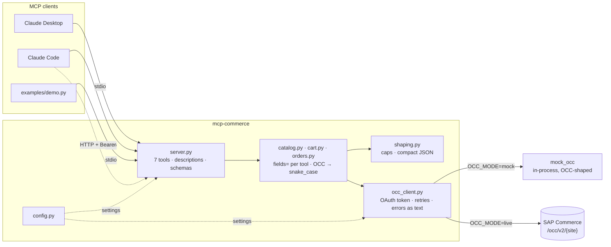

# mcp-commerce

An [MCP](https://modelcontextprotocol.io) server that gives AI agents safe,
token-lean access to **SAP Commerce** through its OCC REST API. Point Claude
Desktop, Claude Code, or any MCP client at it, and an agent can search the
catalog, build a cart, and answer *"where is my order?"* against a real
storefront backend, or against the built-in OCC mock with no setup at all.

Month 2 of the [agentic AI roadmap](../agentic_ai_roadmap/roadmap.md).


*A customer asks about running shoes that haven't arrived, without an order
number. The agent finds the order in the history, sees the shipment is past its
estimate, checks stock, and offers a replacement, all through this server's
tools. Every tool call and result is printed as it happens. Run it yourself
with `uv run examples/demo.py`.*

## The problem

SAP Commerce exposes everything a storefront needs through OCC, its REST API.
OCC was designed for storefront developers who read its documentation. An LLM
agent only reads tool descriptions and tool results, and pointed at OCC
directly it runs into problems a developer never would:

- **Too much surface.** OCC has hundreds of endpoints. An agent choosing among
  80 tools picks worse than one choosing among 7.
- **Too much payload.** Five search hits at OCC's default field level cost
  about 7,200 tokens, mostly images, facets, breadcrumbs and formatted strings
  the model can't use.
- **Surprising semantics.** Adding an out-of-stock item to a cart returns
  **HTTP 200** with `statusCode: noStock` in the body. Asking for a page past
  the end returns 200 with an empty list. Requesting a field that doesn't exist
  omits it silently. Each of these is a place a model guesses wrong.
- **Identity in the URL.** OCC paths look like `/users/{userId}/orders`. If the
  model can choose `userId`, a prompt injection can read someone else's orders.
- **Writes that aren't idempotent.** A retried add-to-cart adds the quantity
  twice.

mcp-commerce is the layer in between: a small set of task-shaped tools, each
returning only what the model needs, with OCC's quirks absorbed server-side
and every failure turned into a message the model can act on.

## Tools

| Tool | Kind | Answers |
|---|---|---|
| `search_products` | read | "Do you have running shoes under 5000?" (keyword, sort by price, in-stock filter, paged) |
| `get_product` | read | "Is it in stock in size 9?" (price, categories, variants with their own stock) |
| `create_cart` | write | Starts a cart; returns a `cart_id` the agent reuses |
| `add_to_cart` | write | "Add two of those." Reports partial adds when stock is short |
| `get_cart` | read | "What's in my cart?" (lines, subtotal, total) |
| `get_order_history` | read | "I don't know my order number." (newest first, status filter) |
| `get_order_status` | read | "Where is my order?" (status, items, each shipment's tracking and dates) |

Read tools carry MCP's `readOnlyHint`, so hosts can auto-approve them and ask
before writes.
One MCP prompt, `where_is_my_order`, gives a human a one-click starting point
(a slash command in most hosts). It frames the task and leaves every fact to
the tools.

## Architecture



A tool call flows left to right:

1. **`server.py`** declares the tools. Argument limits (`page_size` 1–20,
   `quantity` 1–10) live in the JSON schema, so the model sees them before it
   calls. Identity (`users/current`, the base site) is server configuration and
   never a tool argument.
2. **`catalog.py`, `cart.py`, `orders.py`** each own their OCC `fields=` string
   and map the trimmed response to a flat, snake_case shape: one `currency` at
   the top, bare numeric prices, status codes rather than localized labels.
3. **`shaping.py`** caps the lists OCC doesn't page (variants, cart lines, order
   items, shipments), marks a capped result `truncated: true` with the full
   count, and serializes compact JSON.
4. **`occ_client.py`** talks to OCC. It fetches and renews the OAuth token,
   retries only what is safe to repeat, waits out short rate limits, and turns
   every failure into an `OccError` worded for the model.
5. **`mock_occ/`** is a FastAPI app that honours the OCC contract: the same
   paths, field names, `fields=` trimming and quirks. It runs **in-process**
   through httpx's ASGI transport, so mock mode needs no second process. The
   tools can't tell it from a real instance, which is why switching to a real
   backend is a configuration change (`OCC_MODE=live`), not a code change.

## Quickstart

Needs [uv](https://docs.astral.sh/uv/). Python 3.12+ is fetched by uv if missing.

**Without cloning.** `uvx` installs and runs the server in one step, against
the built-in mock by default:

```bash
uvx --from git+https://github.com/nishanhegde/mcp-commerce mcp-commerce --check-config
```

Register it with Claude Code:

```bash
claude mcp add mcp-commerce -- uvx --from git+https://github.com/nishanhegde/mcp-commerce mcp-commerce
```

Then ask *"where is order 1042?"*. Settings go in the client's `env` block (or
`claude mcp add -e OCC_MODE=live -e ...`); see [Configuration](#configuration).

**From a clone**, to run the tests, the Inspector or the demo:

```bash
git clone https://github.com/nishanhegde/mcp-commerce && cd mcp-commerce
uv sync
uv run pytest                                  # tests run against the mock OCC
uv run mcp dev src/mcp_commerce/server.py      # browse and call the tools in the MCP Inspector
```

Claude Code opened in the clone picks up [`.mcp.json`](.mcp.json) and asks you
to approve the server.

**Claude Desktop**: merge [`examples/claude_desktop_config.json`](examples/claude_desktop_config.json)
into `~/Library/Application Support/Claude/claude_desktop_config.json` (macOS)
and restart Desktop. The example runs a clone and defines a mock server and a
live one; for the uvx form, use `uvx` as the command and the arguments above.
Two things differ from a terminal:

- Paths must be absolute. Desktop doesn't use your shell's `PATH` or working
  directory, so `command` is the full path to `uv` or `uvx` (`which uv`) and
  `--directory` points at the clone.
- Startup errors, including configuration problems, go to
  `~/Library/Logs/Claude/mcp-server-mcp-commerce.log`.

**Over HTTP**: start the server with `MCP_TRANSPORT=http MCP_API_KEY=...
uv run mcp-commerce` and connect with
[`examples/mcp.http.json`](examples/mcp.http.json). Claude Code expands
`${MCP_API_KEY}` from your environment.

**The demo agent**:

```bash
cp .env.example .env                # set ANTHROPIC_API_KEY (the demo's, not the server's)
uv run examples/demo.py             # the WISMO flow from the GIF
uv run examples/demo.py "Do you have Trail Pro in size 10?"
```

## Configuration

All settings are environment variables, read and validated once by
[`config.py`](src/mcp_commerce/config.py). Precedence: the process environment (a client's
`env` block, your shell), then `.env` in the working directory, then defaults. A bad
configuration stops the server at startup with every problem listed.

```bash
uv run mcp-commerce --check-config   # print what the server would run with, or what's wrong
```

| Variable | Default | |
|---|---|---|
| `OCC_MODE` | `mock` | `mock`: built-in OCC mock, no setup. `live`: a real SAP Commerce |
| `OCC_BASE_URL` | | Required for live, ignored otherwise. Host root, e.g. `https://localhost:9002` (no `/occ/v2`) |
| `OCC_BASE_SITE` | `shop` | Base site id, e.g. `electronics` |
| `OCC_USER_PATH` | `users/current` | `orgUsers/current` for B2B |
| `OCC_CLIENT_ID` / `OCC_CLIENT_SECRET` | | OAuth client. Alone: client_credentials (catalog tools only) |
| `OCC_USERNAME` / `OCC_PASSWORD` | | With the client: password grant, a customer token (cart and order tools) |
| `OCC_CA_BUNDLE` | | PEM to trust a self-signed dev cert, instead of turning TLS checks off |
| `MCP_TRANSPORT` | `stdio` | `http` for a standalone server |
| `MCP_HOST` / `MCP_PORT` | `127.0.0.1` / `8000` | HTTP only |
| `MCP_API_KEY` | | Required for HTTP; clients send it as `Authorization: Bearer` |

Mock vs live is explicit on purpose: `OCC_BASE_URL` set while `OCC_MODE` is
`mock` is an error, so a misspelt variable can't silently serve mock data.

## Design decisions

The full reasoning is in [`docs/tool-surface.md`](docs/tool-surface.md) (the
tool design, written before the code) and [`docs/occ-quirks.md`](docs/occ-quirks.md)
(every OCC behaviour the server absorbs). The decisions that shaped it most:

**1. Tools model agent tasks, not endpoints.** Each tool answers a question
an agent actually gets asked. `get_order_status` and a full order lookup hit
the same OCC endpoint, but "where is my order?" needs status, items and
shipments, not forty fields. A small result is also harder to mis-summarize.

**2. The model never chooses the identity.** The base site and the user path
(`users/current`, or `orgUsers/current` for B2B) are server configuration. No
tool takes a `userId`, so no prompt can redirect a call to another customer's
data.

**3. Every response is trimmed, and the saving is measured.** Each tool sends
its own `fields=` string, then flattens the result. Measured with the token
counting endpoint (`uv run scripts/measure_tokens.py`):

| One call of each tool | Raw OCC | mcp-commerce |
|---|--:|--:|
| `search_products` (5 hits) | 7,199 | 225 |
| `get_product` (4 variants) | 1,371 | 201 |
| `get_cart` (3 lines) | 984 | 223 |
| `get_order_history` (4 orders) | 707 | 185 |
| `get_order_status` (1 shipment) | 593 | 133 |
| **All five** | **10,854** | **967 (9%)** |

`fields=` does most of the work. The last ~30% came from returning compact
JSON: the MCP SDK pretty-prints a returned dict by default.

**4. Errors are answers.** A failure comes back as an MCP error result
(`isError`) whose text says what happened and what to do next. For example:
*"The commerce backend timed out during an update, so it may or may not have
been applied. Call get_cart to see the cart's actual state before trying
again."* OCC's HTTP-200-but-`noStock` becomes an error, and a partial add
becomes a success that says how many units were actually added. Results that
could be misread get explained too: an empty page past the end says *"Nothing
is wrong with the query"*, so the model doesn't rewrite a good search.

**5. Retry only what repeating can't change.** Reads retry timeouts and 5xx
with jittered backoff. Cart writes don't: if the request may have reached OCC,
a retry could double the quantity. A 401 refreshes the token and replays once,
because OCC rejected the request before running it. A 429 is waited out only
if `Retry-After` is short; otherwise the model is told how long to wait.

**6. Descriptions say when, not just what.** Every tool description has one
sentence on what it does, one on when to call it, and one on the tool it's
easily confused with ("to inspect one product use `get_product`"). Parameter
descriptions name where a value comes from ("cart id returned by
`create_cart`"), which is what lets the model chain calls without asking the
customer for internal ids.

**7. No arguments that would have to lie.** OCC filters price only through
predefined facet ranges. A `max_price` argument would mean post-filtering a page,
which makes the page counts wrong. So `search_products` exposes what OCC
genuinely supports (`sort=price_asc`, `in_stock_only`) and the description
tells the model to read the prices.

**8. Never invent what the backend didn't send.** Carrier and estimated
delivery aren't core OCC fields; they come from a shipping integration, if
there is one. They appear only when present, and the tool description tells
the model never to guess them. Order statuses pass through as strings, not an
enum, because B2B and fulfilment configurations add their own.

**9. B2B is a seam, not a fork.** SAP Commerce B2B changes the user path,
pricing, quantity rules and order states. v1 models B2C, but the path prefix is
configuration and statuses are open strings, so the same tools run against a
B2B site. [`docs/tool-surface.md`](docs/tool-surface.md#b2c-vs-b2b) maps what
else B2B changes, area by area.

**Out of scope for v1, deliberately:** checkout and payment (irreversible,
money-moving; that needs human confirmation designed in), cancellations and
returns, account and address data (PII with no value for these flows), and
anonymous or guest carts.

## Status and limits

- **Verified against the mock, not a real instance.** The live path (OAuth
  password grant, token refresh, retries, 429 handling) is covered by tests that
  script a misbehaving backend through httpx, but it hasn't run against a real
  SAP Commerce. There is no free public sandbox.
- **Single customer.** The identity is one configured user. A shared
  deployment would resolve the user per session from the auth layer, still
  never from a tool argument.
- **Cart expiry.** A `cart_id` that OCC has dropped comes back as "Cart not
  found". The model sees the message, but nothing tells it to start a new cart.

See [`docs/occ-quirks.md`](docs/occ-quirks.md#not-smoothed-over-yet) for the
full list.

## Layout

```
src/mcp_commerce/
  server.py         MCP server: tool definitions, the prompt, transport, auth
  cli.py            the mcp-commerce command (--check-config, --version)
  config.py         every setting, validated at startup
  catalog.py        search_products, get_product
  cart.py           create_cart, get_cart, add_to_cart
  orders.py         get_order_history, get_order_status
  shaping.py        list caps, compact JSON, result budget
  occ_client.py     OCC HTTP client: OAuth, retries, error messages
  mock_occ/         OCC-shaped mock backend (FastAPI, in-process)
examples/           demo agent, Claude Desktop and HTTP client configs
scripts/            measure_tokens.py
docs/               tool-surface.md, occ-quirks.md, demo recording
tests/              pytest, all against the mock
```

## License

[MIT](LICENSE). Contributions welcome: see [CONTRIBUTING.md](CONTRIBUTING.md).
